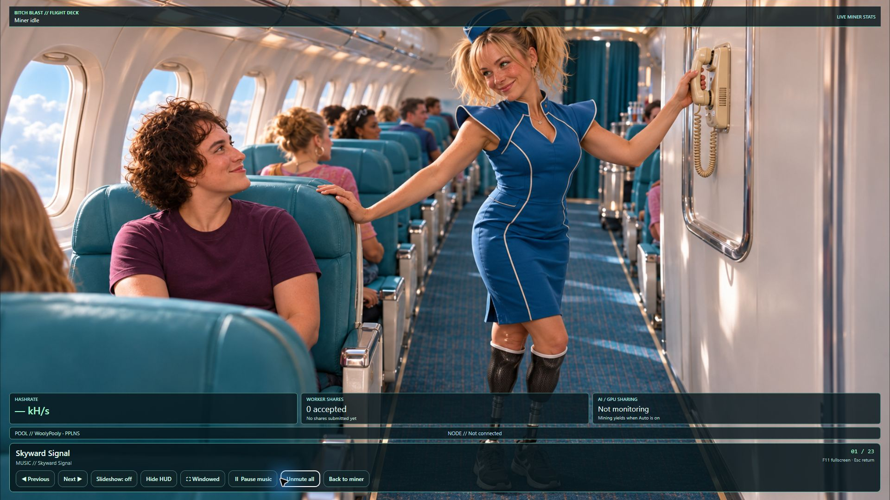
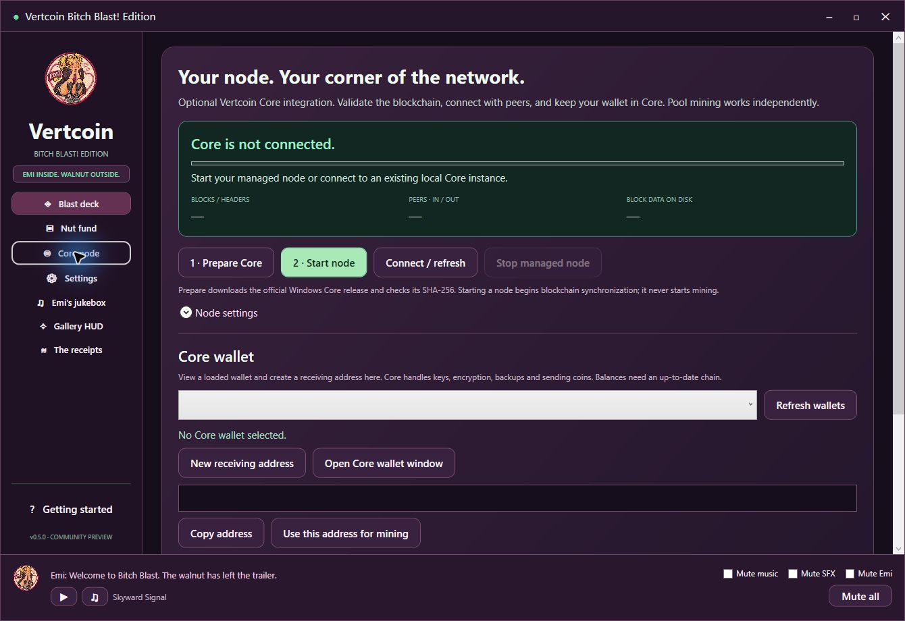
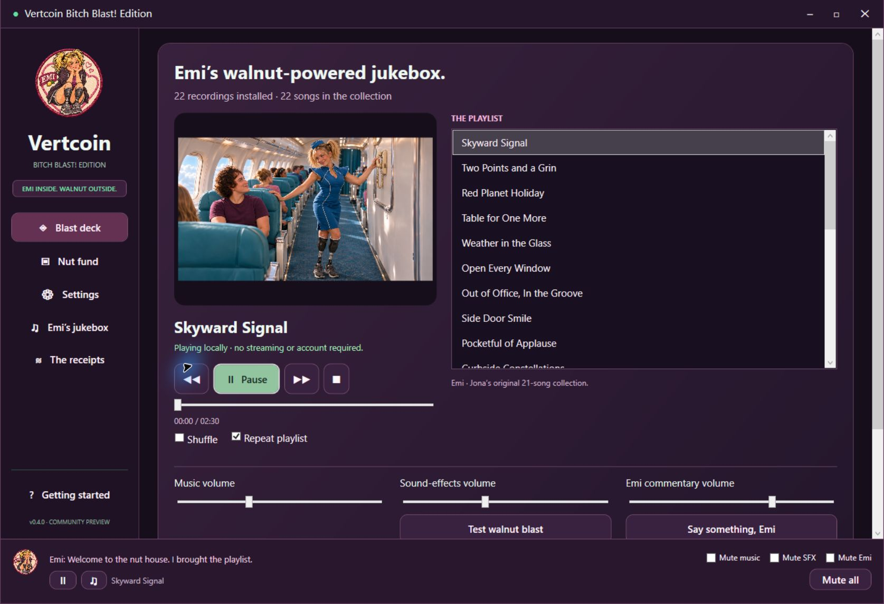

# Vertcoin Bitch Blast! Edition

**Big walnut energy.** A free Windows x64 front end for VerthashMiner, with automatic GPU sharing for local AI, optional Vertcoin Core node and wallet integration, a full-screen gallery with live stats, and a fully offline Emi jukebox. Independent community preview **v0.5.0**; not an official Vertcoin-project release.

[**Download for Windows x64**](https://github.com/jonacitrusthyng/vertcoin-bitch-blast/releases/download/v0.5.0/Vertcoin-Bitch-Blast-v0.5.0-Windows-x64.zip) � [Release, full source and SHA-256 checksums](https://github.com/jonacitrusthyng/vertcoin-bitch-blast/releases/tag/v0.5.0)

The download is unsigned. [73 automated checks and six isolated Core checks passed](TEST-RESULTS.md). Live pool share acceptance, completed payouts and a full mainnet node sync still need field testing.

## Your pictures. Your live stats.

Open the gallery as a separate, resizable window or use **F11**, the **Fullscreen** button, or a double-click on the picture to fill the screen. **Esc** returns to the window; another **Esc** closes it. The gallery fits each picture without cropping it and includes all **23 images**: 21 song covers, Emi's portrait and the walnut/trailer scene.

The green-and-cyan HUD shows actual mining state, hashrate, accepted/rejected shares, AI status, selected pool, local node status and the current song. Hide the HUD for a clean picture, browse with Previous/Next, or turn on the 12-second slideshow. Gallery playback and mute buttons control the existing jukebox; they do not start a second audio player or change whether mining is running.



## Optional Vertcoin Core node and wallet

- **Prepare Core** downloads official Core v23.2 and checks the pinned archive SHA-256. **Start node** starts it explicitly; **Connect / refresh** can read an already-running local instance.
- View sync progress, blocks/headers, peers, pruning state and loaded wallet balances. Core runs separately from GPU mining. Running a node by itself does not earn mining rewards.
- Create an encrypted Core wallet with a confirmed passphrase of at least 12 characters, request a receiving address, and explicitly choose **Use this address for mining**. Keys stay in Core's wallet files; Bitch Blast does not save your encryption passphrase.
- **Open Core wallet window** opens the official GUI for backups, recovery and sending coins. It gracefully replaces a managed daemon using the same data folder. Existing instances that the app only connected to are not stopped or replaced.
- RPC uses local cookie authentication on loopback. Router and firewall changes are manual and optional. Outbound syncing works without port forwarding; inbound peers use **TCP 5889**, while **RPC 5888 stays local**.

The default managed node has its own `%LOCALAPPDATA%\VertcoinBitchBlast\Core` data folder, a 2,048 MiB block-file pruning target, and graceful shutdown on app close. The target excludes other databases and Core's additional **1.28 GB Verthash file**. Initial setup may generate that file before sync begins. Disk-only Verthash mode reduces RAM use but can slow validation. Read the [Core setup, wallet and router guide](docs/CORE-NODE.md) before starting your node.



## Emi brought the playlist

- All **21 original Emi recordings**, plus **No Permission Slip**: 22 songs, about 55 minutes, bundled locally.
- Matching cover art, lyrics, play/pause/stop, previous/next, seeking, shuffle and playlist repeat.
- **15 spoken Emi reactions** and **five sound effects**, including the walnut blast and accepted-share chime.
- Separate **Mute music**, **Mute SFX** and **Mute Emi** controls, plus **Mute all** and three volume sliders. Preferences survive restart. Music lowers while Emi speaks.
- Music starts when you press Play. Commentary can greet you on launch unless muted. No account, streaming, microphone, or cloud speech service is used by the app.




*AI-generated fan artwork featuring our adult Emi interpretation. [Artwork credits](docs/ARTWORK.md).*

## Start here

1. Extract the Windows ZIP and open **VertcoinBitchBlast.exe**. The .NET runtime is included; no administrator privileges are needed.
2. Choose **Nut fund**, paste your public **Vertcoin mainnet receiving address**, and save. The app checks the address checksum. You can also create an encrypted wallet through the optional Core panel and explicitly use its receiving address for mining. Back up that wallet in the official Core GUI before funding it. **Set up a Core wallet** opens the integrated Core panel.
3. In **Settings**, click **Prepare miner + data**. This downloads VerthashMiner 0.7.2 from its official GitHub release, checks a pinned SHA-256, and generates the canonical 1,283,457,024-byte Verthash file locally. Allow several minutes and at least 1.4 GB of free disk space. Setup can be cancelled. You can instead browse to an existing miner and data file.
4. **Scan GPUs**, choose the GPU to mine with, and save settings. **Test GPU offline** checks hashing for up to 35 seconds without a wallet or pool connection. The default intensity is 75% and the temperature limit is 75�C. Monitoring support depends on the device and driver. This release selects one GPU per mining session.
5. On **Blast deck**, select **WoolyPooly**, **Zpool**, **Suprnova**, or **Custom pool**. **Check pool** tests the Stratum subscription. Click **Blast off � start mining**. In Auto mode, the app waits for 30 seconds of continuous AI idle time first.
6. **Stop mining** releases the worker. Closing the app also stops its worker, including if the app crashes. The app never enables mining automatically on launch.

## Upgrading from an earlier community preview

Close the previous app, extract the new ZIP into its own folder, and launch **VertcoinBitchBlast.exe**. The existing `%LOCALAPPDATA%\VertcoinGarden` data directory and single-instance lock are retained for compatibility, so saved pool/GPU settings and prepared miner data remain usable. A saved worker name is preserved; new configurations default to `ocm`.

Core is optional and is not started by upgrading. Its default data folder is separate from both the miner's files and an existing standard Core installation. The existing 22-song collection and independent audio settings remain available.

## Your payout destination

The miner accepts an address from an existing wallet or one you explicitly select from the integrated Core panel. Core creates and holds any Core wallet's keys; Bitch Blast reads balances and requests receiving addresses through local RPC. It does not send coins, unlock wallets or export private keys through its integration. Use **Open Core wallet window** for the official wallet's full controls.

Rewards are sent by the selected pool according to its fee, payment schedule, and payout threshold. **View payouts** opens the pool's website; WoolyPooly lets you paste your address into its dashboard search. **Open my wallet** in the payout panel uses the registered `vertcoin:` handler when available. A Core wallet balance is separate from funds still held by a pool, and an unsynced or scanning wallet may not yet show its current balance.

The interface deliberately has no sample balances or invented income estimates. Hashrate and accepted/rejected share counts come from the actual miner log. Share counters restart when the worker restarts, including after an AI pause. Changing the payout address does not transfer balances that remain at a pool under an old address. Check the receiving address before starting.

## Automatic AI / GPU sharing

- **Auto on:** watches active and queued inference in LM Studio, llmster, and Bionic through the installed `lms` CLI. An idle loaded model may remain loaded. Remote LM Link inference is excluded. Busy AI stops the entire owned mining worker, releasing its GPU allocations; continuous idle time starts a fresh worker.
- **Unknown status:** holds mining paused if a running supported host cannot report its state. The app does not launch AI applications to check their status.
- **Other AI tools:** configurable process names reserve the GPU while any matching process runs. Defaults include Ollama, llama-server, and ComfyUI. Add `python` if that is how your local AI application appears in Task Manager. This conservative fallback may hold mining paused for an idle server process.
- **Auto off:** manual mining ignores AI state. Another miner still prevents the app from starting a competing worker.

Checks occur roughly once per second, and status calls can take up to five seconds. Very short requests and initial model loading may happen between checks. Stop mining before loading a large model if available VRAM is tight. There is no universal detector for every AI application, GPU task, game, or browser. The app observes inference/process state; it does not read prompts or responses.

## Pools

The curated pool list was checked on 2026-11-17. Pool availability, fees, and terms can change. There is no automatic switch to a different pool; selection stays under your control. Custom pools use `stratum+tcp://host:port`, your receiving address as username, and the password/options entered in Settings. Account-name pools are outside this address-based setup.

| Pool | Endpoint | Password/options | Source |
|---|---|---|---|
| WoolyPooly PPLNS | `pool.woolypooly.com:3102` | `x` | [Pool instructions](https://woolypooly.com/en/coin/vtc) |
| Zpool | `verthash.mine.zpool.ca:6144` | `c=VTC,zap=VTC` | [Official OCM catalog](https://github.com/vertcoin-project/one-click-miner-vnext/blob/master/pools.json), [pool terms](https://zpool.ca/) |
| Suprnova anonymous VTC | `vtc.suprnova.cc:1776` | `x` | [Official OCM catalog](https://github.com/vertcoin-project/one-click-miner-vnext/blob/master/pools.json) |

A successful connection check means the server answered `mining.subscribe`. It does not prove that it will authorize a payout address, accept a share, or make a payment. The miner performs authorization and reports failures through The receipts. Zpool's non-guaranteed VTC payout availability follows its own terms; read them before use.

## Local files and privacy

Miner configuration, the downloaded worker, and generated miner data are stored in `%LOCALAPPDATA%\VertcoinGarden`. The optional Core programs are installed beneath that directory; the managed node's default chain data and wallets are in `%LOCALAPPDATA%\VertcoinBitchBlast\Core`. The original Vertcoin OCM wallet and configuration are not modified. The app settings contain a public receiving address and pool options, never a recovery phrase, wallet private key or wallet encryption passphrase. Core owns its own encrypted wallet files and local authentication cookie; do not share those files.

VerthashMiner writes timestamped logs alongside its executable. Those logs may contain your payout address and pool connection details; review them before sharing. There is no telemetry, automatic mining/node startup or installed background service. You can explicitly leave a Core process running after closing Bitch Blast; otherwise the app requests a graceful stop of only the Core process it launched.

The source contains all pool settings and miner launch arguments. It invokes the miner directly, without a command shell. Windows assigns each mining process to a job at creation time so it cannot be orphaned if the app exits. The UI is local WPF and does not load executable web content.

## Build and verify

On Windows, with a .NET SDK that supports targeting .NET 8. The full Source ZIP includes every media file. A Git clone contains the code, artwork, voice and effects; run `fetch-music.ps1` once to install the checksum-verified music/cover pack from this release before building:

```powershell
# Git clones only; unnecessary for the full Source ZIP:
.\fetch-music.ps1
.\build.ps1
.\build\tests\OcmTests.exe
# Optional read-only checks against the live pool endpoints:
.\build\tests\OcmTests.exe --pools
# Read local AI status without starting a miner:
.\build\tests\OcmTests.exe --ai
```

See **TEST-RESULTS.md** for the verification record and remaining limits. The source and Windows build are supplied together for inspection. The executable is unsigned. No antivirus exclusions or security-setting changes are performed by the app.

## Upstream resources

- [VerthashMiner source and usage](https://github.com/CryptoGraphics/VerthashMiner)
- [Pinned official VerthashMiner 0.7.2 Windows release](https://github.com/CryptoGraphics/VerthashMiner/releases/tag/0.7.2)
- [Pinned official Vertcoin Core v23.2 release](https://github.com/vertcoin-project/vertcoin-core/releases/tag/v23.2)
- [Core setup and router guide](docs/CORE-NODE.md)
- [Vertcoin Core address prefixes](https://github.com/vertcoin-project/vertcoin-core/blob/master/src/chainparams.cpp)
- [LM Studio CLI inference-status fields](https://github.com/lmstudio-ai/lms/blob/main/src/subcommands/list.ts)

The application source is MIT licensed. VerthashMiner is a separate GPL-3.0 program, downloaded from upstream during setup; its license and source remain available from that project. Vertcoin Core is a separate MIT-licensed upstream program, optionally downloaded during Core preparation. See [media credits](docs/MEDIA-CREDITS.md) and [artwork notes](docs/ARTWORK.md) for the supplied and generated creative assets. This fan edition does not change the Vertcoin network's official branding.
